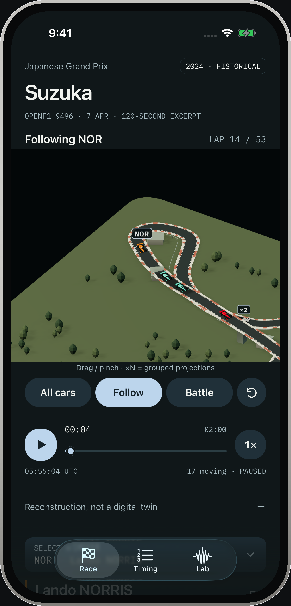
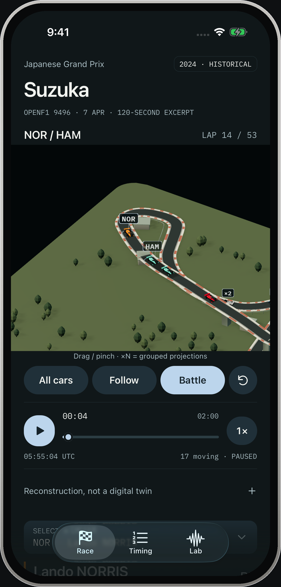
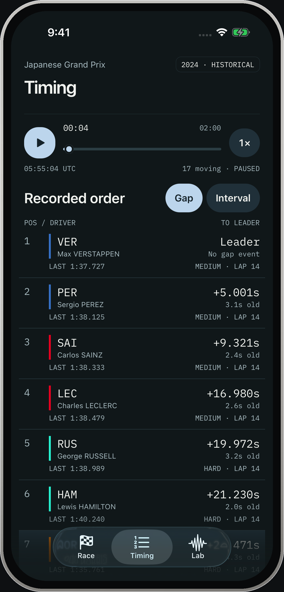
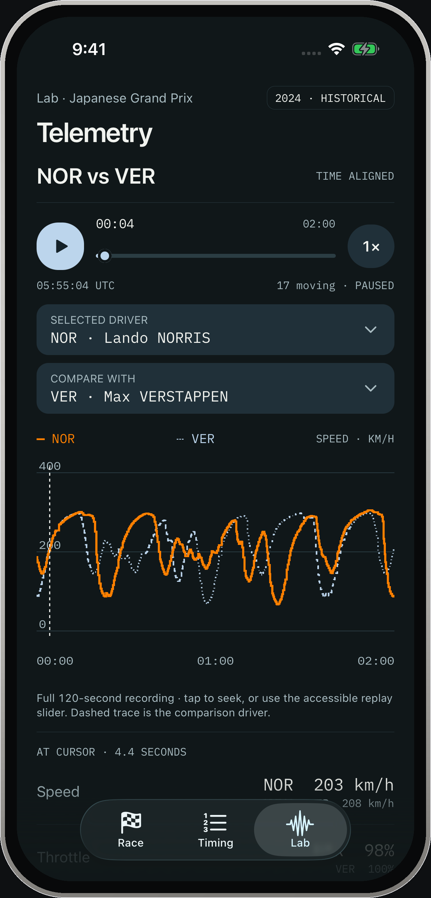
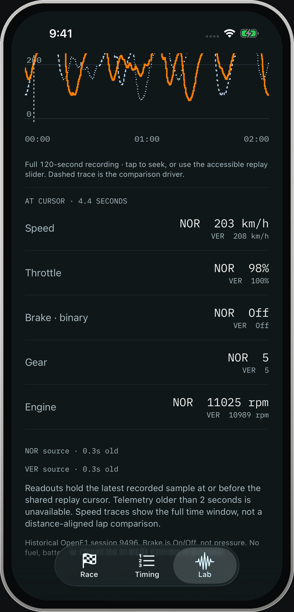
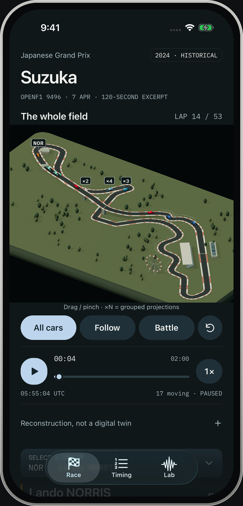

<div align="center">
  

  <h1>Vantage</h1>

  <p><strong>A native 3D Formula 1 miniature and historical replay.</strong><br />
  The whole Suzuka field, recorded telemetry and three cameras — drawn natively with Three.js, Expo GL and Metal/WebGPU.</p>

  <p>
    <a href="#run"></a>
    <a href="#run"></a>
    <a href="#run"></a>
    <a href="#run"></a>
    <a href="#status-october-2026--pre-release"></a>
  </p>
</div>

Vantage is a real-time 3D Formula 1 replay app. The native client in `mobile/` (Expo SDK 58 · React Native 0.88 · React 19.3) draws a full circuit, the recorded field of 17 moving cars and three camera modes with Three.js, using Expo GL on Android and react-native-webgpu (Dawn/Metal) on iOS — no WebView, no video playback. It replays the 2024 Japanese Grand Prix fixture from documented OpenF1 recordings and follows the product direction approved in `DIRECTION.md`.

> [!IMPORTANT]
> **Vantage is pre-release.** The native replay is built and verified on Android and the iPhone 17 Pro Simulator. Physical-iPhone behaviour, GPU pacing, thermals, accessibility and commercial data rights are not verified, and nothing is on the App Store.

## See it in use

<p align="center">
  <a href="Showcase/vantage-demo-framed.mp4">
    
  </a>
</p>

<p align="center">
  <a href="Showcase/vantage-demo-framed.mp4"><strong>Watch the 37-second hands-on demo</strong></a><br />
  <sub>Native iOS · 60 fps · One continuous take · Real taps, camera moves and scrolling</sub>
</p>

The whole-field overview, Follow and Battle cameras, seeking, 2× speed, Timing,
Lab comparison, telemetry values and the whole-field finish. The app is driven by
a UI test on the iPhone 17 Pro Simulator with the bundled OpenF1 excerpt; the 3D
scene is moving, not a sequence of mockups.

[Recording notes and website embed](Showcase/README.md).

Every screenshot and frame below is a real iPhone 17 Pro capture from the iOS 26.5
Simulator. The device frame is drawn around the capture; the app pixels inside it
are untouched.

## Screens

<p align="center">
  
  <br />
  <sub><strong>Race</strong> — the whole field at 00:04. Seventeen moving streams, recorded lap and timing, and ×N badges where projected cars overlap.</sub>
</p>

<table>
  <tr>
    <td width="50%" valign="top">
      
      <br /><sub><strong>Follow</strong> — NOR through the hairpin. Drag to orbit, pinch to zoom; the selected car keeps its label and ground ring.</sub>
    </td>
    <td width="50%" valign="top">
      
      <br /><sub><strong>Battle</strong> — NOR and HAM in one frame. Group counts disclose overlapping projections rather than inventing lanes.</sub>
    </td>
  </tr>
  <tr>
    <td width="50%" valign="top">
      
      <br /><sub><strong>Timing</strong> — recorded order with gap or interval, last lap and source age. Sparse events are not inferred from the miniature.</sub>
    </td>
    <td width="50%" valign="top">
      
      <br /><sub><strong>Lab</strong> — time-aligned speed traces for the selected pair, plus the shared cursor and telemetry below.</sub>
    </td>
  </tr>
  <tr>
    <td width="50%" valign="top">
      
      <br /><sub><strong>Telemetry</strong> — speed, throttle, binary brake, gear and RPM at the shared cursor, with source age beside each driver.</sub>
    </td>
    <td width="50%" valign="top">
      
      <br /><sub><strong>Return</strong> — returning to Race keeps the shared cursor and selected driver; the replay does not silently resume.</sub>
    </td>
  </tr>
</table>

## Status (October 2026) — pre-release

Verified on a physical Samsung Note 20 5G (Android 13, release APK) and an iPhone 17 Pro Simulator (iOS 26.5):

- Native Race / Timing / Lab screens, the shared replay engine and Overview / Follow / Battle cameras.
- Android: startup, camera change and moving-field pixel gates pass — real GL-region comparisons, not UI-only checks.
- iOS Simulator: the Metal/WebGPU backend now draws the moving field and camera changes; the real pixel gate passes (446,917 camera / 24,120 moving-field changed pixels). The old EXGL simulator freeze is bypassed.
- Task/timing pacing, the overview framing fix and Android 2× SSAA are measured on-device (`RENDER-STABILITY.md`).
- Android 2× supersampling (sRGB target, linear then direct fallback) cuts the Note20 hard-step fraction 0.640 → 0.298. It roughly doubles measured GPU frame cost; 100s playback is 3.99% janky vs 1.72% without it, so 60fps is not claimed.
- Follow/Battle re-captured after the framing change; the Android camera/motion gate passes on the SSAA build (359,314 / 324,496 changed pixels).
- 110s Android SSAA camera sweep: no sustained blackout in the sampled recording (4Hz; shorter faults and ghosting are not excluded).
- `cd mobile && npm run check` — TypeScript, ESLint and 41 pure tests pass.

Not yet established:

- Physical iPhone behaviour. The video and stills are iPhone Simulator captures; no physical iPhone has run the app. Haptics, thermals and real-device GPU pacing remain unverified.
- Sustained Android 2× SSAA performance and SoC thermals beyond the 100s aggregate run. The pacing figure is HWUI/GPU contention, not a Perfetto GPU trace; a 1.5× experiment traded sharpness for GPU headroom without a consistent jank win, and no adaptive mode is shipped.
- A GPU-trace-level profile, p99 hitches, intermittent blackouts, ghosting, and any device beyond the Note20 and iPhone Simulator.

No store submission. The local APK is debug-key signed — not a Play Store artifact. No live-data integration and no commercial rights clearance; see `REFERENCES.md`.

## Layout

| Path | What it is |
| --- | --- |
| `mobile/` | Native app (Expo + React Native; Expo GL on Android, Metal/WebGPU on iOS). Run/build instructions in `mobile/README.md`. |
| `replay-prototype/` | Browser proof the app grew out of: 17 moving cars, seekable clock, recorded telemetry. |
| `assets/` | Editable 3D circuit sources (`.blend`), renders, fonts and licences. |
| `shots/` | Dated visual evidence: design sheets, device captures, measured before/after pairs. |
| `Screenshots/framed/` | Framed iPhone 17 Pro screenshots used by the README. Raw captures live in `shots/ios-showcase/`. |
| `Showcase/` | 37-second continuous, hands-on iPhone Simulator walkthrough, GIF preview and capture provenance. |
| `references/` | Primary-source research material. |
| `scripts/` | Python scene-render and design-validation scripts. |

## Run

```sh
# Native app
cd mobile && npm ci && npm run check        # typecheck + lint + tests
npm start                                    # Metro dev server
npm run build:android                        # local release APK (debug key, not Play signing)
npm run build:ios                            # simulator .app

# Browser replay proof (no install, no network)
python3 replay-prototype/serve.py            # http://127.0.0.1:8765/replay-prototype/
```

## Records

`DIRECTION.md` (brief and approved direction) · `NATIVE-RENDERER.md` (EXGL/Three architecture) · `NATIVE-VALIDATION.md` (device acceptance gates) · `RENDER-STABILITY.md` (measured render quality, open defects) · `NATIVE-POLISH.md` · `CRITIQUE*.md` · `REFERENCES.md`.

## Retained: working historical replay prototype

`replay-prototype/` now contains a local browser proof with **17 moving 3D cars**, overview/follow/battle cameras, a seekable 120-second clock and synchronized recorded timing/telemetry from the 2024 Japanese GP. Twenty real driver streams; three stationary streams are not animated. This is not the simulated 22-car design state, a native app or a live product.

```sh
python3 replay-prototype/serve.py
# Open http://127.0.0.1:8765/replay-prototype/
```

No runtime API calls, credentials or npm install. See `replay-prototype/README.md` for controls, scope, rebuilding and rights; `replay-prototype/data/SOURCES.md` for provenance. `shots/replay/validation.json` records passing browser interactions at desktop/768/402/375/320px, reduced motion and no JS/HTTP errors. Seven logic tests pass. Responsive emulation is not native device/performance validation. Lane placement, pit paths and elevation remain illustrative; commercial/live rights remain unresolved.

**Phone-test update:** iOS26.5 Safari **in the simulator** renders the scene and completes the three-camera sample. No physical iPhone/Android is connected; actual-phone feel/performance remains blocked. `replay-prototype/PHONE-TEST.md` documents the opt-in diagnostics, private test server and what the user must run on a reachable handset. Ten pure tests and phone-tooling checks pass; simulator rAF cadence is not a native/GPU performance claim.

## Approved visual baseline: selected A, expanded

 Seven app screens, a camera storyboard and the app icon, plus working browser motion studies. These are visual concepts with simulated data—not an implemented live race product.

- `presentation-a2.html`: complete gallery plus camera dive, linked telemetry scrubber, timing tick, pit-loss scenario and reduced-motion controls.
- `reply-a2.html`: compact inline gallery and camera/timing/pit motion studies.
- `mockup.html`: editable native-size frame set; Gap/Interval, the shared telemetry cursor and pit assumption are functional.
- `shots/a2-r2/sheet.png`: latest full-suite contact sheet; individual3× frames in the same folder.
- `shots/a2-r2-small/`: 375×667 phone validation.
- `CRITIQUE-A2.md`: two full-set rounds, **45→48/60**, all12 final criteria4/5. Both final scans have zero FAILs and exactly7 type sizes.
- `scripts/validate_a2.mjs`: functional checks at728/390/320px plus system reduced motion; `shots/a2-validation.json` records the passing results.

The30-frame camera journey moves through real rendered geometry; cars remain fixed at a simulated moment. No live feed, native haptic, Android implementation or data-rights clearance is claimed.

The original three-direction exploration is preserved below.

## Open

- `presentation.html`: comparison gallery; select A, B or C to enlarge. Native gallery controls work; the pictured app controls are visual proposals.
- `explore.html`: editable iPhone-screen source, using the local app-designer device kit and Apple fonts for mockups.
- `shots/explore-r2/sheet.png`: latest contact sheet.
- `shots/explore-r2/`: individual 3× screens at 402×874.
- `shots/explore-r2-small/`: individual 3× screens at 375×667.

## Design decisions

`DIRECTION.md` contains the user-confirmed brief, reference synthesis, refused defaults, three concepts, tokens, exact demo content, proposed signature and recommended direction A. The user selected A and approved the expanded visual baseline; the historical browser proof continues that direction.

`CRITIQUE.md` records two independent review rounds and all warning responses. `REFERENCES.md` records primary-source research and the difference between historical/free access and commercially cleared live data.

## Original assets

`assets/circuit-{a,b,c}.blend` are editable 3D source scenes. Cars, terrain, bridge, Ferris wheel, grandstands, buildings and lighting were procedurally authored in `scripts/render_circuits.py`. Blender 5.1.2/Cycles was used for the supplied renders.

Suzuka plan geometry is MIT-licensed; the licence is preserved in `assets/CIRCUIT-LICENSE.txt`. Elevation, structures and scale are illustrative, not surveyed. Positions and timing gaps in the original static assets are simulated; the separate historical prototype uses documented OpenF1 recordings. No broadcast footage, official car mesh, sponsor artwork or paid generated imagery is used.

## Validation

Both final phone-size scan runs exit 0, with zero FAILs. Warnings are answered in `CRITIQUE.md`. Gallery view switching was checked at 728px, 390px and 320px with no horizontal overflow, broken images or JavaScript errors; results are in `shots/gallery-checks.json`.

To reshoot on this machine:

```sh
node /Users/pratikrai/.pi/agent/skills/app-designer/scripts/shoot.mjs explore.html --out shots/next
node /Users/pratikrai/.pi/agent/skills/app-designer/scripts/shoot.mjs explore.html --out shots/next-small --width 375 --height 667
```

The mockup links to this machine's app-designer device CSS/JS. For sharing elsewhere, package those dependencies and ensure appropriate font licences; do not bundle Apple font files for Android.

## Next validation gate

Test the replay interaction on actual phones and measure frame times, then explicitly choose the native/cross-platform implementation stack. Live integration, commercial rights, native performance, real-device motion/haptics, subscriptions and Android-specific adaptation remain unverified. The original A/B/C exploration is retained as history, not an open direction decision.
