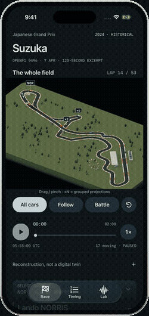

# Vantage — hands-on demo

**[Watch the demo](./vantage-demo-framed.mp4)** · 34 seconds · 780 × 1626 · 30 fps · 2.1 MB

A continuous, normal-speed recording of the native iOS app:

1. The whole-field overview.
2. Follow and Battle cameras.
3. Seeking, 2× speed and the Timing tab.
4. The Lab speed traces, comparison driver sheet and telemetry values.
5. A return to the whole field.

The recording uses the bundled 2024 Japanese GP OpenF1 excerpt on the iOS 26.5
Simulator. It demonstrates the working app, not mockups or a marketing slideshow.

## Preview and sharing

[](./vantage-demo-framed.mp4)

Use the MP4 for a portfolio, recruiter email or direct message. The GIF is a
smaller animated preview for GitHub READMEs; click it to open the full-quality
video.

For a website, upload the MP4 and use:

```html
<video controls muted playsinline preload="metadata"
  aria-label="Vantage hands-on app demo"
  style="display:block;width:100%;max-width:360px;height:auto">
  <source src="vantage-demo-framed.mp4" type="video/mp4">
  <a href="vantage-demo-framed.mp4">Watch the Vantage demo</a>
</video>
```

## The iPhone frame

Every published capture comes from one device: the **iPhone 17 Pro** on the
iOS 26.5 Simulator — 402 × 874 points at 3× (1206 × 2622 pixels). The Android
evidence in `../RENDER-STABILITY.md` is separate and is not used in this deck.

| File | Size | What it is |
|---|---|---|
| `vantage-demo-framed.mp4` | 780 × 1626 | The demo inside the drawn iPhone 17 Pro frame |
| `vantage-demo-framed.gif` | 250 × 530 | Animated preview of the same |
| `vantage-demo.mp4` | 720 × 1566 | The same recording with no frame, for full-screen playback |
| `vantage-demo.gif` | 190 × 414 | Frameless GIF |

The frame is a static titanium band and black glass drawn around the capture.
Inside it:

- The app pixels are **byte-identical** to the source. Verified on the stills:
  maximum difference **0** across the entire screen area, with only the four
  55 pt screen corners rounded, exactly as a real display curves into the body.
- The recording is never cut, stitched, retimed or sped up inside the take. Only
  the head and tail are trimmed. Both files carry the **identical 1,020 frames in
  the identical order**, at the same 34.0-second duration.
- Comparing the framed video against the frameless one, the app region differs
  only by H.264 re-encoding noise (sampled mean **1.75/255**; max 41 at
  high-contrast edges). No frame is shifted or dropped.

## Capture notes

- Native iOS Release build, captured on the iPhone 17 Pro Simulator.
- Driven by `NativeShowcase.testShortVideo` in
  [`../mobile/scripts/native-smoke/NativeShowcase.swift`](../mobile/scripts/native-smoke/NativeShowcase.swift);
  recorded with `xcrun simctl io recordVideo`.
- No internal cuts, scene stitching, inserted holds or playback-speed changes.
  Head and tail are trimmed to remove the launch/test setup.
- No touch overlay is drawn. The app's own motion and controls are the focus.
- The full MP4s pass a decode check; the preview GIFs are downsampled and
  palette-quantised for README playback, and the MP4s retain the full 30 fps.
- Machine-readable evidence: [vantage-demo.capture.json](./vantage-demo.capture.json).

The frame is produced by [create-demo.py](./create-demo.py), the same static-frame
pipeline used for the Monolith repository. It frames both the stills and the video
from the same iPhone Simulator captures; it does not use a browser mockup or a
screenshot sequence.
